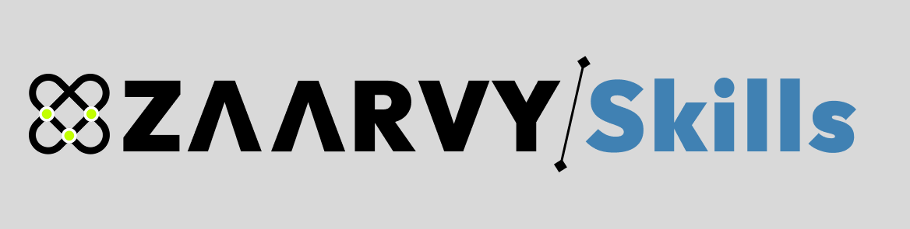

<div align="center">


<br />
<br />

**Zero-Install, Agent-Native Skills Warehouse for AI Coding Agents**

[](LICENSE)
[](https://github.com/anthropics)
[](#-agent-compatibility--quickstart)
[](#-validation--testing)

<p align="center">
  A curated catalog of progressive-disclosure agent skills engineered for instant drop-in compatibility across modern AI coding agents (Claude Code, Cursor, Antigravity, OpenCode).
</p>

</div>

---

## 🚀 Core Value Proposition

1. **Zero-Install Progressive Disclosure**: Written in the open Agent Skills markdown format with lean instructions, contextual triggers, explicit boundary constraints, and zero heavy dependencies.
2. **Cross-Agent Universality**: Directly compatible out-of-the-box with **Claude Code**, **Cursor**, **Google Antigravity**, and **OpenCode CLI**.
3. **Deterministic & Production-Ready**: Each skill is verified against concrete test fixtures with strict behavioral constraints and predictable output contracts.

---

## 📦 Foundational Skills Index

| Skill | Category | Description | Primary Triggers |
| :--- | :--- | :--- | :--- |
| [`context-diet`](skills/context-diet/SKILL.md) | `optimization` | Strips comments, docstrings, and redundant lines while preserving 100% functional logic (saves ~50–65% tokens). | Files > 100 lines, context compression, prompt pruning |
| [`pr-distiller`](skills/pr-distiller/SKILL.md) | `code-analysis` | Distills multi-file unified git diffs into executive risk ratings, breaking change audits, and changelogs. | Git diff reviews, PR audits, pre-merge checks |
| [`api-contract-mocker`](skills/api-contract-mocker/SKILL.md) | `mocking` | Synthesizes realistic JSON test fixtures and zero-dependency in-memory Fetch interceptors from OpenAPI/Swagger. | OpenAPI / Swagger specs, frontend mocking, API stubs |

---

## 🛠️ Agent Compatibility & Quickstart

### 1. Claude Code
To load a skill directly into your Claude Code workspace:
```bash
mkdir -p .claude/skills
cp -r skills/context-diet .claude/skills/
```

### 2. Cursor IDE
To map any skill to a Cursor workspace rule:
```bash
mkdir -p .cursor/rules
# Point your cursor rule to the skill instruction:
cp skills/pr-distiller/SKILL.md .cursor/rules/pr-distiller.mdc
```

### 3. Google Antigravity
To install globally or locally in your Antigravity skills repository:
```bash
# Workspace level
mkdir -p .gemini/skills
cp -r skills/api-contract-mocker .gemini/skills/

# Global level
cp -r skills/context-diet ~/.gemini/config/skills/
```

---

## 🧪 Validation & Testing

`zaarvy-skills` includes a zero-dependency verification script to validate skill frontmatter, folder integrity, and registry alignment:

```bash
# Run verification across all skills
node scripts/verify-skills.js

# Regenerate and sync registry.json automatically
node scripts/verify-skills.js --sync

# Validate a single skill
node scripts/verify-skills.js --skill context-diet
```

---

## 🤝 Contributing

Contributions of new agent skills are welcome! See [`CONTRIBUTING.md`](CONTRIBUTING.md) for architecture guidelines, frontmatter specifications, and the PR verification checklist.

---

## 📄 License

Distributed under the [MIT License](LICENSE). Built for the open agent ecosystem by Zaarvy Contributors.
