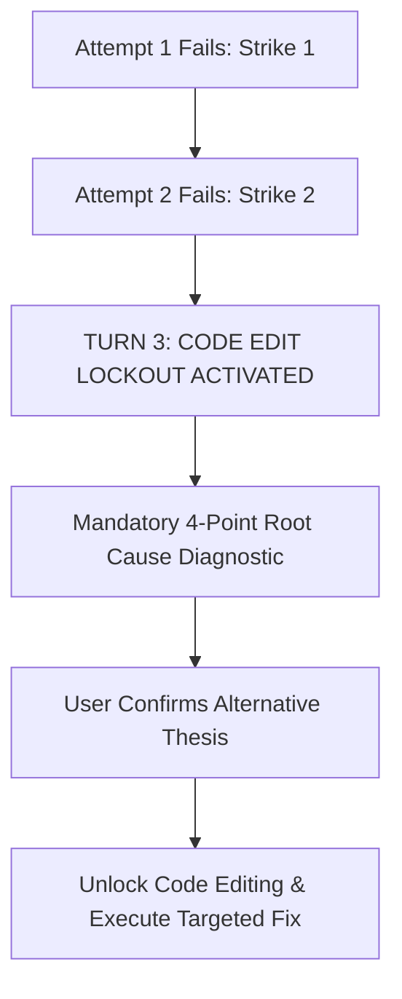

# loop-breaker

> **Circuit breaker for agent debugging: halts repetitive code thrashing after 2 failed fixes and forces root-cause diagnosis.**

[](../../README.md)
[](https://github.com/anthropics)

---

## ⚡ The Problem: Debugging Thrash

When an AI agent encounters a failing test or build error, it often enters a **trial-and-error death spiral**:
- **Attempt 1:** Adds a 100ms `setTimeout`. *(Fails)*
- **Attempt 2:** Increases it to 300ms and adds a boolean flag. *(Fails)*
- **Attempt 3:** Shuffles statements randomly or comments out the failing assertion. *(Fails)*
- Result: 10 wasted turns, burned API credits, and corrupted code.

---

## 🛠️ The Fix: Two-Strike Circuit Breaker

`loop-breaker` imposes strict discipline on the agent's reasoning loop:



1. **Turn-3 Code Edit Lockout**: On Turn 3 after two consecutive failures, the agent is **strictly forbidden** from editing files (`write_file`, `edit_file`).
2. **Diagnostic Receipt**: The agent must output:
   - **Flawed Root Assumption:** What incorrect belief drove attempts 1 & 2.
   - **Mechanism of Failure:** Why the previous approaches failed.
   - **Alternative Architectural Thesis:** A fundamentally different hypothesis.
   - **Minimal Experiment:** A read-only verification check before writing code.

---

## 📋 Diagnostic Output Format

```markdown
### 🛑 Loop Breaker: Diagnostic Lockout (Turn 3)
**Target:** `useAuth.ts` | **Consecutive Failures:** 2

1. Flawed Root Assumption: Assumed requests needed delay; in reality, multiple concurrent requests are firing independent refresh calls.
2. Mechanism of Failure: `setTimeout` worsens race conditions instead of sharing state.
3. Alternative Architectural Thesis: Attach all incoming callers to a shared singleton `refreshPromise`.
4. Proposed Verification: Check `apiClient.ts` to confirm singleton interceptor support before editing.
```

---

## 🚀 Quickstart

### Claude Code
```bash
cp -r skills/loop-breaker .claude/skills/
```

### Cursor
```bash
cp skills/loop-breaker/SKILL.md .cursor/rules/loop-breaker.mdc
```

### Antigravity
```bash
cp -r skills/loop-breaker ~/.gemini/config/skills/
```
